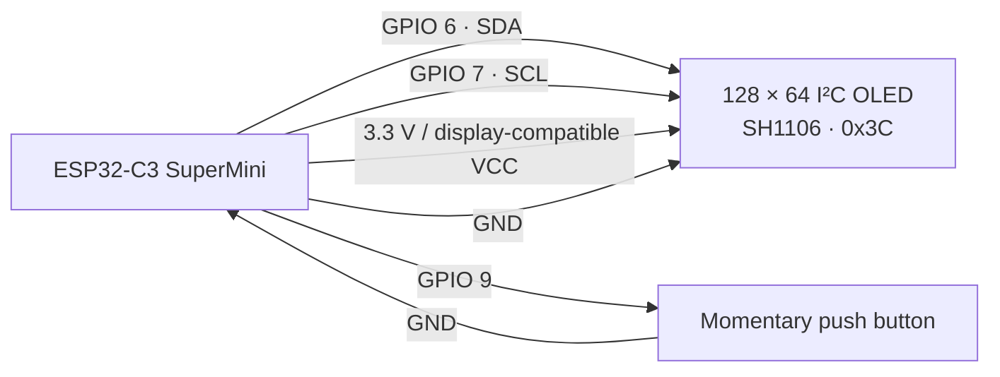

# RoboEyes — ESP32-C3 Emotion Display

A small animated robot-eyes display built with an **ESP32-C3 SuperMini**, a **128 × 64 SH1106 I²C OLED**, and one push button. Each press selects a new expression; after 2.5 seconds, the eyes return to their idle animation.

## What it does

- Renders animated eyes on an SH1106 OLED display.
- Starts in a curious, blinking idle state.
- Cycles through four expressions with a button press: **happy → curious → annoyed → sad**.
- Returns to idle automatically after 2.5 seconds.
- Uses internal pull-up input and a 250 ms software debounce for the button.

## Hardware

| Part | Quantity | Notes |
| --- | ---: | --- |
| ESP32-C3 SuperMini | 1 | Arduino-compatible ESP32-C3 board |
| 128 × 64 I²C OLED | 1 | SH1106 controller; address `0x3C` |
| Momentary push button | 1 | Normally open |
| Jumper wires | As needed | |

> **Power note:** Connect the OLED's `VCC` to the supply voltage specified for your particular display module. The ESP32-C3 GPIO signals are 3.3 V logic.

## Wiring diagram



| ESP32-C3 SuperMini pin | Connect to | Purpose |
| --- | --- | --- |
| `GPIO 6` | OLED `SDA` | I²C data |
| `GPIO 7` | OLED `SCL` | I²C clock |
| `3V3` | OLED `VCC`* | Display power |
| `GND` | OLED `GND` | Shared ground |
| `GPIO 9` | One leg of button | Button input |
| `GND` | Other leg of button | Button ground |

\*Confirm the VCC requirement printed on the OLED module before powering it.

The sketch configures `GPIO 9` as `INPUT_PULLUP`, so no external resistor is required: a pressed button connects the pin to ground.

## Software requirements

Install these libraries from the Arduino Library Manager:

- **Adafruit GFX Library**
- **Adafruit SH110X**
- **FluxGarage RoboEyes**

Also install the **ESP32 by Espressif Systems** board package through Arduino IDE’s Boards Manager, then select the ESP32-C3 board profile that matches your SuperMini.

## Getting started

1. Create or open an Arduino sketch named `roboeyes`.
2. Copy the project sketch into `roboeyes.ino`.
3. Install the board package and libraries listed above.
4. Wire the display and button exactly as shown in the diagram.
5. In Arduino IDE, choose the correct ESP32-C3 board and serial port.
6. Upload the sketch.
7. Open Serial Monitor at **115200 baud** if you need to view initialization errors.

## Button behavior

| Press | Expression | Visual behavior |
| ---: | --- | --- |
| 1 | Happy | Laugh animation |
| 2 | Curious | Eyes look north-east |
| 3 | Annoyed | Angry mood with horizontal flicker |
| 4 | Sad | Tired mood, looking down |
| Next | Happy | The cycle repeats |

Every selected expression is held for **2.5 seconds**, then the display returns to its idle animation with blinking and curiosity enabled.

## Configuration

These values are near the top of `roboeyes.ino` and can be changed to match your hardware or desired timing:

```cpp
#define OLED_SDA        6
#define OLED_SCL        7
#define BUTTON_PIN      9
#define OLED_ADDRESS    0x3C
#define EMOTION_HOLD_MS 2500
```

- If the display stays blank, check the I²C address. Common OLED addresses are `0x3C` and `0x3D`.
- If you use different I²C pins, update `OLED_SDA` and `OLED_SCL`.
- Increase `EMOTION_HOLD_MS` to keep an expression visible longer.

## Troubleshooting

| Symptom | Check |
| --- | --- |
| OLED remains blank | Confirm power, ground, SDA/SCL pins, and the I²C address. |
| `OLED initialization failed!` in Serial Monitor | Verify the display controller is SH1106 and that it responds at `0x3C`. |
| Button never changes expression | Make sure the button connects `GPIO 9` to `GND` only when pressed. |
| Button triggers repeatedly | Check the wiring and ensure a normally-open momentary button is used. |
| Compilation error for a header | Install the corresponding library listed in Software requirements. |

## Project structure

```text
roboeyes/
├── roboeyes.ino       # Arduino sketch
└── README.md          # Project documentation
```

## License

Copyright (c) 2026 Yukiene404 Permission is hereby granted, free of charge, to any person obtaining a copy of this software and associated documentation files (the "Software"), to deal in the Software without restriction, including without limitation the rights to use, copy, modify, merge, publish, distribute, sublicense, and/or sell copies of the Software, and to permit persons to whom the Software is furnished to do so, subject to the following conditions: The above copyright notice and this permission notice shall be included in all copies or substantial portions of the Software.
